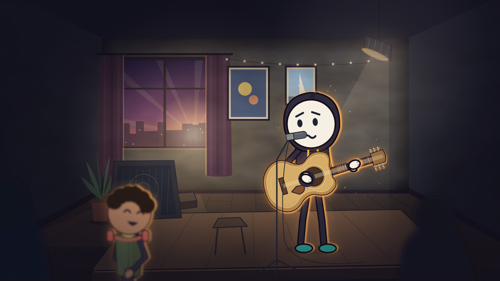
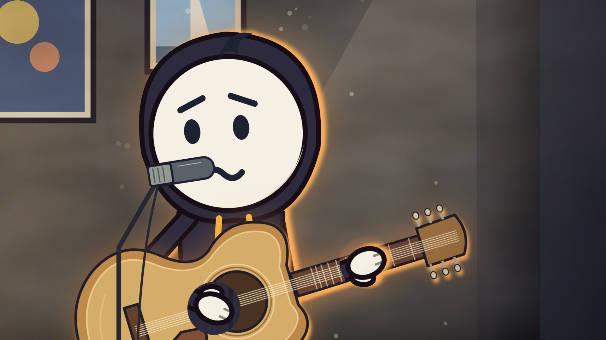
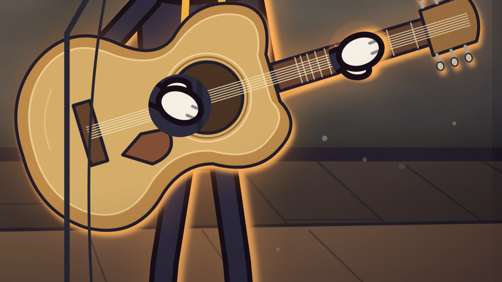

# आने दो — code-generated frame examples

A scene study for an original Hindi short about showing up even when you feel insecure about your appearance. Aarav is about to play his first line at a small café open mic; Samar watches from the audience.

These are three camera views of **one still scene**, not three animated shots or a finished Hindi video. The scene uses the upstream `Hero` rig (`pipHood` and `mo`), room/perspective kit, lamp cones, rim filters, depth blur, and deterministic dust. The guitar is positioned from the rig's hand joints with a two-link arm solve.

| View | Example |
| --- | --- |
| Stage wide, 2560 × 1440 |  |
| Character close-up, 1920 × 1080 |  |
| Guitar and hands, 1920 × 1080 |  |

## Reproduce

From the repository root, with Node 18+ installed:

```bash
cd studio
npm install
npm run typecheck
node render-aane-do.mjs
```

The renderer writes these PNGs into `examples/aane-do/`. To inspect/edit the compositions:

```bash
npx remotion studio src/index.ts
```

Choose `AaneDoWhatIfFrame`, `AaneDoClose`, or `AaneDoDetail`. Source: [`AaneDoWhatIfFrame.tsx`](../../studio/src/AaneDoWhatIfFrame.tsx). All artwork in this example is SVG authored in code; no image/video generation service is called. Rendering these stills requires no ElevenLabs key and used **0 new ElevenLabs credits**.

[Hindi story script](script-hi.md) is a writing draft for the longer film. No Hindi voiceover or full Hindi video is included here. Review a full storyboard before animating it.

Built on [kelano86/what-if-animation](https://github.com/kelano86/what-if-animation), retaining its MIT license and original attribution. The upstream sample episodes remain included. These additions do not change the upstream repository.
